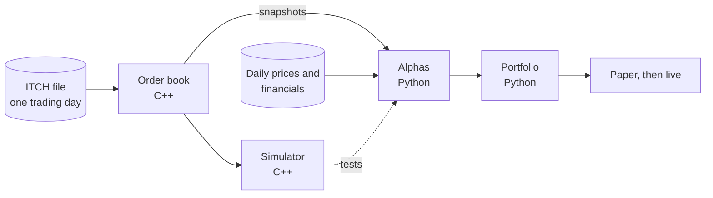

<h1 align="center">AlphaDesk</h1>

  Raw exchange messages in, a trading portfolio out. 
  A quant trading stack I'm building from scratch in C++ and Python.

  
  
  
  

## What is this

I wanted to know what actually happens between an exchange sending a message
and a firm placing a trade, so I'm building every step myself.

It starts with Nasdaq's ITCH feed: every order added, cancelled and executed
in a day, about 8 GB of binary. It ends with a small portfolio trading real
money.

## The pieces

| Piece | Language | What it does |
|---|---|---|
| Order book | C++ | Decodes ITCH and rebuilds the book for every stock, one order at a time |
| Simulator | C++ | Replays a day through a strategy. My orders wait in the queue behind the real ones |
| Alphas | Python | Signals from my own book data, and from daily prices and financials (WRDS) |
| Portfolio | Python | Combines the signals and sizes positions under risk limits |
| Trading | Python | Paper trading first, then live with small money (Alpaca) |

## Things I care about

- The book has to be right before it's fast. I check it against the feed
  itself: executions hit the best price, the book never crosses, every cancel
  finds its order, and nothing is left at the close.
- Backtests lie easily. Everything gets tested on data it hasn't seen, with
  trading costs in, and the ideas that fail get written up too.
- No black boxes. If I can't write it myself, I don't use it yet.

## Progress

- [x] Design and plan
- [ ] ITCH decoder (working on this now)
- [ ] Order book
- [ ] Simulator
- [ ] First alphas
- [ ] Portfolio
- [ ] Paper trading
- [ ] Live, small
- [ ] Later: the ITCH decoder again, on an FPGA

## Docs

- [Design](docs/DESIGN.md)
- [Plan](docs/AlphaDesk-plan.pdf)
- [Notes on how firms get data, and what a student can get](docs/research/hft-access-and-simulation.md)
