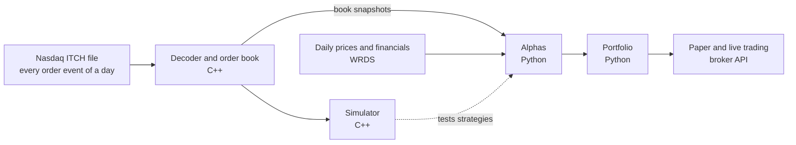

# AlphaDesk

A small version of a quant trading stack, built from scratch: from raw exchange
messages to a portfolio that trades.

## The idea

A trading firm's pipeline has the same steps everywhere: read the exchange's
data, rebuild the order book, simulate strategies against it, find signals,
turn the signals into a portfolio, and send orders.

Most student projects cover one step, usually a backtest on daily prices that
someone else prepared. AlphaDesk covers the whole chain on real exchange data,
with each piece written by hand, so that I understand how the pieces depend on
each other.

## How it fits together

## What it emphasises

- **Real exchange data.** The input is Nasdaq TotalView-ITCH, the feed trading
  firms use: every order added, cancelled and executed, stamped to the
  nanosecond. The order book is rebuilt one order at a time, not downloaded.
- **Correctness first.** The book is checked against the feed itself: every
  execution must hit the best price, the book must never cross, every cancel
  must find its order, and the book must be empty at the close.
- **Realistic simulation.** A simulated order waits in line behind the real
  orders that were there first and fills only when they do. The same run gives
  the same result every time.
- **Honest research.** Each alpha is measured for how well it predicts, how
  fast it fades and how much it trades. Results are reported on data the model
  never saw, with costs included. An idea that fails gets written up too.
- **One path from research to trading.** The portfolio code that runs in the
  backtest is the code that places paper and live orders, behind risk limits
  and a kill switch.
- **Written to learn.** I write the C++ and Python myself. The goal is to
  understand what quant researchers and quant developers do, not to assemble
  libraries.

## Tools

- **C++20 and CMake** for the decoder, order book and simulator.
- **Python** for alphas, testing and portfolio construction.
- **Data:** Nasdaq ITCH sample days, CRSP and Compustat through WRDS, Alpaca
  for live prices and paper trading.
- **AWS** for the daily job that runs without me.

## Status

Early. The design and plan are written, and the first piece, the C++ ITCH
reader, is in progress. This page describes where the project is going. I will
update it as each piece lands.

Planned for later: the ITCH reader again on an FPGA, and a way for other people
to submit alphas.

## Docs

- [docs/DESIGN.md](docs/DESIGN.md): the stages of the platform.
- [docs/AlphaDesk-plan.pdf](docs/AlphaDesk-plan.pdf): the schedule and budget.
- [docs/research/hft-access-and-simulation.md](docs/research/hft-access-and-simulation.md):
  what data a student can get and how firms work.
