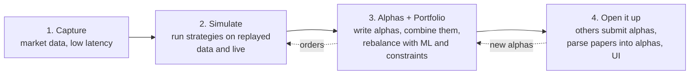

# AlphaDesk

A platform that captures market data fast, lets me write and test alphas, turns
them into a portfolio, and runs it. Traditional markets: equities, futures,
options. Built in C++ and Python over nine months as a way to learn what HFT
engineers do.

## The four stages

## 1. Capture

Read raw exchange data feeds and build the order book for each symbol, as fast
as possible. Record everything to disk with timestamps.

- Language: C++.
- The goal is a number: microseconds from packet in to book updated.
- Learn: binary protocols, order books, memory and cache, lock-free queues,
  measuring latency.

## 2. Simulate

Play recorded data back through the same code as if it were live, and run a
strategy against it. The strategy should not know whether it is live or
replay. Later, connect the same code to a broker for paper and then real
trading with small money.

- Language: C++ for the engine, broker connection in whichever is easiest.
- Learn: event-driven design, determinism, order state machines, risk limits,
  why backtests lie.

## 3. Alphas and portfolio

Write alphas as small functions: data in, signal out. Test each one: how
predictive is it, how fast does it decay, how correlated is it with the
alphas I already have. Combine the good ones with ML, then build a portfolio
under constraints (exposure, position size, turnover) and rebalance it
automatically.

- Language: Python.
- Alpha types: price and volume, fundamentals, microstructure from stage 1 data.
- Learn: backtesting without cheating, IC and Sharpe, overfitting, convex
  optimisation.

## 4. Open it up

Let someone else submit an alpha and get a report back. Let someone describe
an idea in words or paste a paper, have an LLM turn it into alpha code, and
run it through the same tests. Put a simple UI on top.

- Language: Python.
- Learn: APIs, sandboxing other people's code, structured LLM output.

## Order of building

| Months | Stage |
|---|---|
| 1 to 3 | Capture |
| 4 to 5 | Simulate |
| 6 to 7 | Alphas and portfolio |
| 8 | Run it live, small |
| 9 | Open it up |

## Rules I am holding myself to

- Integers for prices, never floats.
- Nothing on the hot path allocates memory after startup.
- Same strategy code in replay and live.
- Every performance claim has a benchmark behind it.
- I write the code. Design docs and reviews are where I get help.
